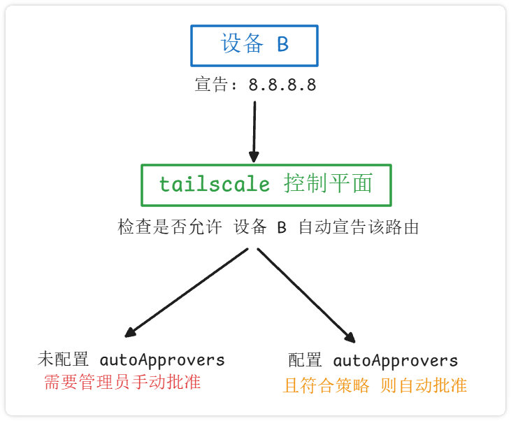

区分两个概念:
1. 路由宣告: 某台设备告诉 tailscale, 这些目标 ip 可以通过我访问
2. 路由批准: tailscale 管理员决定是否接受这些宣告

## 3类路由宣告

1. **子网路由** (Subnet Routes): 宣告本地网络 CIDR 范围
2. **出口节点** (Exit Node): 作为互联网出口的节点宣告的 `0.0.0.0/0` 和 `::/0` 路由
3. **App Connectors**: 连接器动态解析域名后, 将对应的 ip 地址作为路由进行宣告

## 路由审批

Tailscale 不会仅仅因为某台设备宣称自己能够转发, 就无条件信任它. 这里有一个审批环节:




- 对于 **Exit Node**, **Subnet Routes**, 可以直接在后台手动批准
- 对于 app connector, 它会根据域名的 DNS 解析结果, 动态发现并宣告路由, 就需要配合 `autoApprovers`


一个 autoApprovers 示例:

```json
"autoApprovers": {
  "routes": {
    "10.0.0.0/24": ["tag:subnet-router"], // 自动批准 Subnet Routes
    
	"exitNode": ["tag:exit-node"],        // 自动批准 Exit Node
    
    "0.0.0.0/0": ["tag:my-connector"],    // 自动批准 Connector 宣告的所有 ipv4 地址
    "::/0": ["tag:my-connector"]          // 自动批准 Connector 宣告的所有 ipv6 地址
  }
}
```
